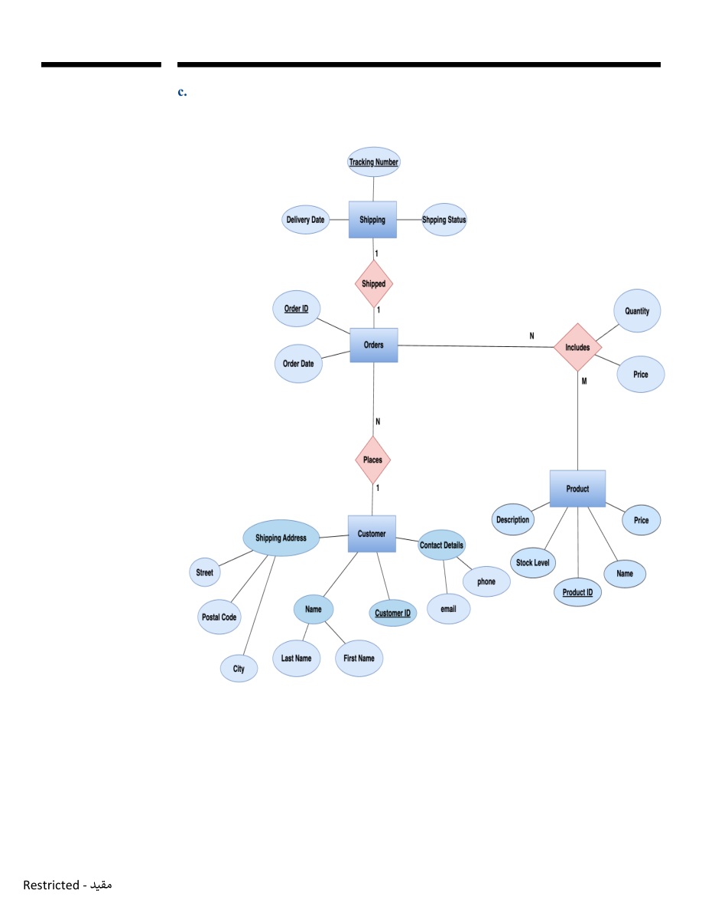

# E-Commerce Inventory and Order Management Database

An academic relational database project for products, customers, orders and shipping. Includes an entity-relationship diagram, normalization discussion, SQL schema, sample data and reporting queries.

## Data model

- **Product:** product descriptions, pricing and stock levels.
- **Customer:** names, contact details and addresses.
- **Orders:** customer orders and statuses.
- **OrderProducts:** line items linking orders and products.
- **Shipping:** tracking numbers, statuses and delivery dates.

## ER diagram

## SQL files

Run these scripts in order using a MySQL-compatible SQL environment:

1. `sql/01_schema.sql` - table definitions.
2. `sql/02_sample_data.sql` - demonstration records.
3. `sql/03_queries.sql` - six reporting queries.

The reporting queries cover out-of-stock items, product sales, overdue shipments, frequent customers, inventory value and today's orders.

## Validation and scope

- The recovered schema and sample data were executed in SQLite with foreign keys enabled; all six queries were exercised using SQLite's `date('now')` in place of MySQL's `CURDATE()`. See [query-validation.json](docs/query-validation.json).
- MySQL execution has not been verified in this workspace. Check foreign-key enforcement for your database version; the original schema uses inline references.
- Original identifier `ShppingStatus` is retained to match the report. Dates in sample inserts were normalized to ISO format; demonstration phone numbers and emails were anonymized.
- This is a database project, not a complete e-commerce website. No claim is made that inventory updates, shipping integrations or production security controls are implemented.

## Team and attribution

Academic group project by **Ghadi Abdullah Alqahtani**, **Joud Bashammakh**, and **Shuruq Alotaibi**. Ghadi served as team leader, coordinating work and reviewing deliverables.

## Report

See [project-report.pdf](docs/project-report.pdf). This portfolio copy omits the assignment cover and instruction pages. Demonstration contact values have been masked where present in extractable text. Original references, diagrams and report content are retained.
